# Incident Management System

Application web de gestion des incidents informatiques et de cybersécurité. Elle permet aux employés de signaler un incident, aux techniciens de traiter les incidents qui leur sont affectés et aux administrateurs de piloter la plateforme.

## Sommaire

- [Aperçu](#aperçu)
- [Fonctionnalités](#fonctionnalités)
- [Rôles](#rôles-et-autorisations)
- [Cycle de vie dun incident](#cycle-de-vie-dun-incident)
- [Technologies](#technologies)
- [Architecture](#architecture)
- [Structure du projet](#structure-du-projet)
- [Installation et lancement](#installation-et-lancement)
- [API REST](#api-rest)
- [Sécurité](#sécurité)
- [Captures décran](#captures-décran)

## Aperçu

L’application propose une interface dédiée à chaque rôle :

- un espace employé pour déclarer un incident et suivre ses déclarations ;
- un espace technicien pour consulter les incidents affectés et faire évoluer leur statut ;
- un espace administrateur avec des statistiques, la gestion des incidents et la gestion des comptes.

Les écrans utilisent un tableau de bord, des indicateurs de suivi et des tableaux de données. Les niveaux de priorité et les statuts sont mis en évidence pour faciliter le repérage des incidents urgents.

## Fonctionnalités

- Création de compte et connexion.
- Déclaration d’incidents avec titre, catégorie, priorité et description.
- Consultation par un employé de ses propres incidents.
- Affectation d’un incident à un technicien par un administrateur.
- Consultation par un technicien de ses incidents affectés et mise à jour de leur statut.
- Consultation de l’ensemble des incidents par l’administration.
- Statistiques globales sur les utilisateurs et les incidents.
- Activation et désactivation des comptes utilisateurs.
- Consultation et modification du profil utilisateur.

## Rôles et autorisations

| Rôle | Principales actions |
|---|---|
| **EMPLOYEE** | Créer un compte, déclarer des incidents et suivre ses propres déclarations. |
| **TECHNICIAN** | Consulter les incidents qui lui sont affectés et mettre à jour leur statut. |
| **ADMIN** | Consulter les statistiques, gérer les incidents et les affectations, administrer les comptes. |

L’accès aux écrans et aux opérations dépend du rôle connecté. Les employés ne consultent que leurs incidents ; les techniciens travaillent sur les incidents affectés.

## Cycle de vie d’un incident

Les statuts utilisés par le projet sont :

1. **OPEN** — incident nouvellement déclaré ;
2. **ASSIGNED** — incident affecté à un technicien ;
3. **IN_PROGRESS** — incident en cours de traitement ;
4. **RESOLVED** — incident résolu ;
5. **CLOSED** — incident clôturé.

Les priorités disponibles sont **LOW**, **MEDIUM**, **HIGH** et **CRITICAL**. Les catégories comprennent notamment **NETWORK**, **MALWARE**, **PHISHING**, **ACCESS**, **SOFTWARE**, **HARDWARE**, **DATA_LEAK** et **OTHER**.

## Technologies

| Composant | Technologies |
|---|---|
| Frontend | React 19, JavaScript, Vite |
| Navigation | React Router |
| Appels HTTP | Axios |
| Icônes | Lucide React |
| Backend | Java 21, Spring Boot 4 |
| API et validation | Spring Web, Spring Validation |
| Persistance | Spring Data JPA, Hibernate |
| Authentification | Spring Security, JWT, BCrypt |
| Bases de données | Dépendances H2 et MySQL disponibles |
| Tests backend | JUnit et Spring Boot Test |

## Architecture

Le frontend React communique avec l’API REST Spring Boot via Axios. L’API applique les règles d’authentification et d’autorisation avant d’accéder aux services, aux repositories et à la base de données.

```text
Navigateur
    │
    ▼
Frontend React / Vite (http://localhost:5173)
    │ Axios + JWT
    ▼
API REST Spring Boot (http://localhost:8081)
    │
    ├── Spring Security
    ├── Services
    ├── Repositories JPA
    └── Base de données (H2 ou MySQL selon la configuration)
```

## Structure du projet

```text
IncidentManagement/
├── backend/
│   └── incident-management/
│       ├── src/main/java/       # API, sécurité, services, entités et repositories
│       ├── src/main/resources/  # Configuration de l’application
│       ├── src/test/            # Tests backend
│       └── pom.xml
├── frontend/
│   ├── src/
│   │   ├── api/                 # Configuration Axios
│   │   ├── context/             # Contexte d’authentification
│   │   ├── pages/
│   │   │   ├── admin/
│   │   │   ├── employee/
│   │   │   └── technician/
│   │   └── routes/
│   └── package.json
├── docs/
│   ├── diagrams/
│   └── screenshots/
├── screens/                     # Captures d’écran numérotées de l’interface
└── README.md
```

## Installation et lancement

### Prérequis

- JDK 21 ;
- Maven 3.9 ou ultérieur ;
- Node.js et npm ;
- une base de données configurée pour le backend (H2 ou MySQL).

### 1. Récupérer le projet

```bash
git clone https://github.com/houdariyad-etu-gif/IncidentManagement.git
cd IncidentManagement
```

### 2. Configurer et démarrer le backend

Vérifiez la configuration dans `backend/incident-management/src/main/resources/application.properties` avant le démarrage : base de données, port du serveur et secret JWT. Le frontend utilise actuellement `http://localhost:8081` comme URL de l’API dans `frontend/src/api/axiosConfig.js` ; adaptez cette URL si le backend écoute sur un autre port.

```bash
cd backend/incident-management
mvn spring-boot:run
```

Pour exécuter les tests backend :

```bash
mvn test
```

### 3. Démarrer le frontend

Dans un second terminal, depuis la racine du dépôt :

```bash
cd frontend
npm install
npm run dev
```

Ouvrez l’adresse indiquée par Vite, généralement [http://localhost:5173](http://localhost:5173).

Pour produire et prévisualiser le build frontend :

```bash
npm run build
npm run preview
```

Le frontend et le backend doivent être lancés séparément. Assurez-vous également que l’origine du frontend est autorisée par la configuration CORS du backend.

## API REST

Les principales routes consommées par l’application sont récapitulées ci-dessous. Les opérations protégées nécessitent une authentification.

### Authentification

| Méthode | Route | Description |
|---|---|---|
| `POST` | `/auth/register` | Créer un compte employé |
| `POST` | `/auth/login` | Ouvrir une session et obtenir les informations d’authentification |

### Incidents

| Méthode | Route | Description |
|---|---|---|
| `POST` | `/api/incidents` | Déclarer un incident |
| `GET` | `/api/incidents/my` | Lister les incidents de l’employé connecté |
| `GET` | `/api/incidents/assigned` | Lister les incidents affectés au technicien connecté |
| `GET` | `/api/incidents/{id}` | Consulter un incident |
| `GET` | `/api/incidents` | Lister les incidents (administration) |
| `PUT` | `/api/incidents/{id}/status` | Modifier le statut d’un incident |
| `PUT` | `/api/incidents/{id}/assign/{technicianId}` | Affecter un incident à un technicien |

### Administration et profil

| Méthode | Route | Description |
|---|---|---|
| `GET` | `/api/admin/statistics` | Consulter les statistiques de la plateforme |
| `GET` | `/api/admin/users` | Lister les comptes utilisateurs |
| `PUT` | `/api/admin/users/{id}/enable` | Activer un compte |
| `PUT` | `/api/admin/users/{id}/disable` | Désactiver un compte |
| `GET` | `/api/profile` | Consulter le profil connecté |
| `PUT` | `/api/profile` | Modifier le profil connecté |

## Sécurité

- Les mots de passe sont destinés à être stockés sous forme hachée avec BCrypt.
- Les routes authentifiées utilisent des jetons JWT.
- Les autorisations sont contrôlées selon le rôle de l’utilisateur.
- Les employés et techniciens ont un accès limité à leurs incidents et affectations.
- Ne publiez jamais de secret JWT, de mot de passe ou de données de test réelles dans le dépôt. Utilisez des variables d’environnement et des secrets adaptés pour tout déploiement.

## Captures d’écran

Voici quelques vues représentatives de l’application :

| Tableau de bord administrateur | Déclaration d’un incident |
|---|---|
| 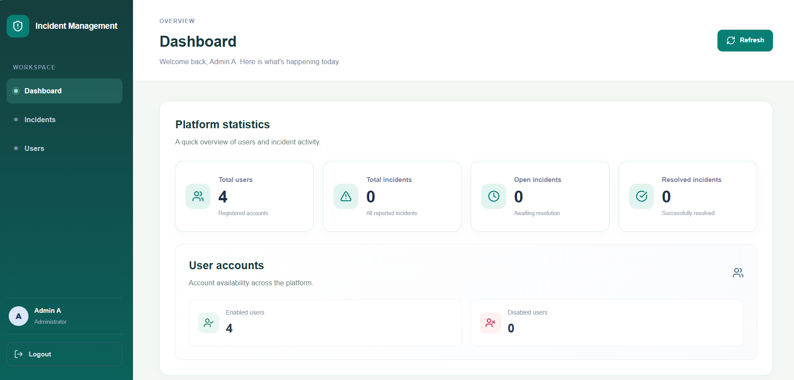 | 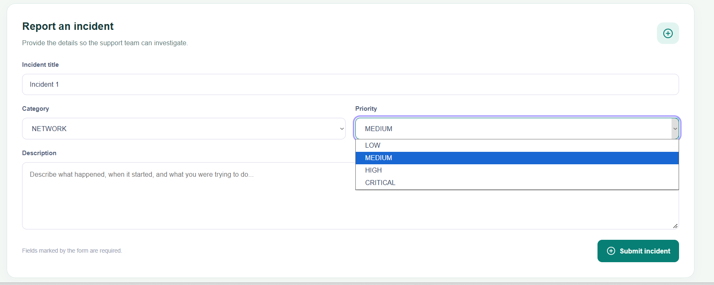 |

| Gestion des utilisateurs | Gestion et affectation des incidents |
|---|---|
| 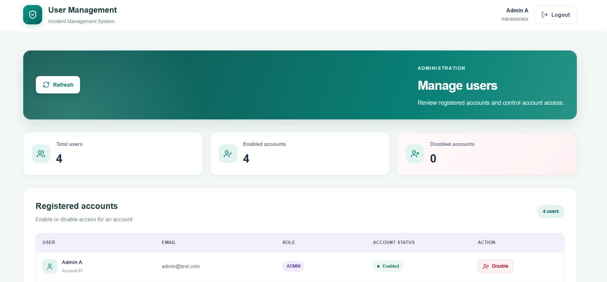 | 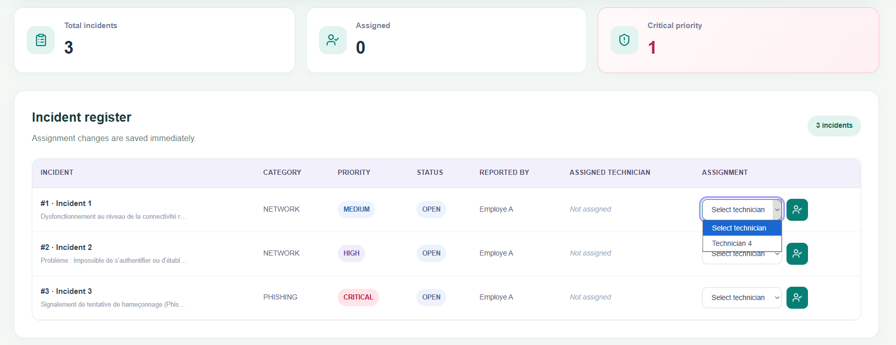 |

| Tableau de bord technicien | Suivi et mise à jour du statut |
|---|---|
| 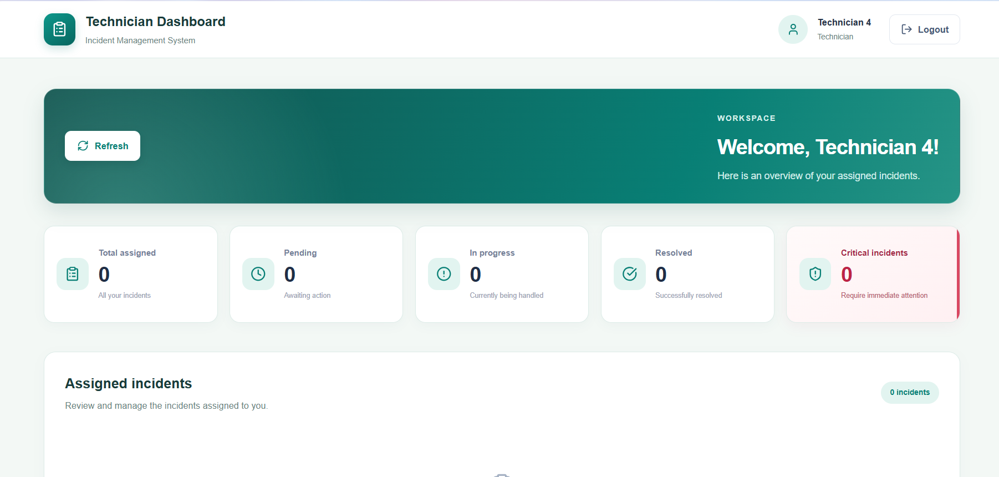 | 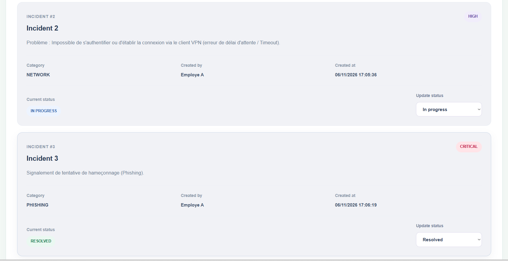 |

<details>
<summary>Afficher la galerie complète des 22 captures</summary>


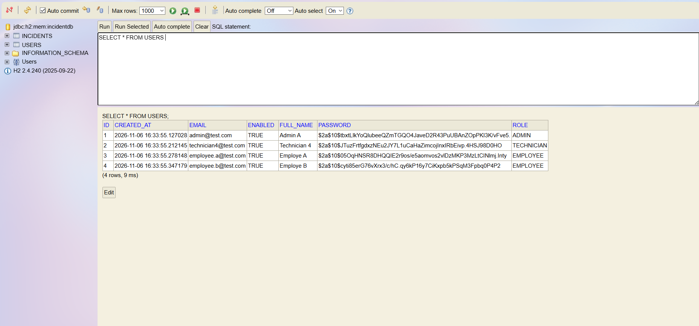
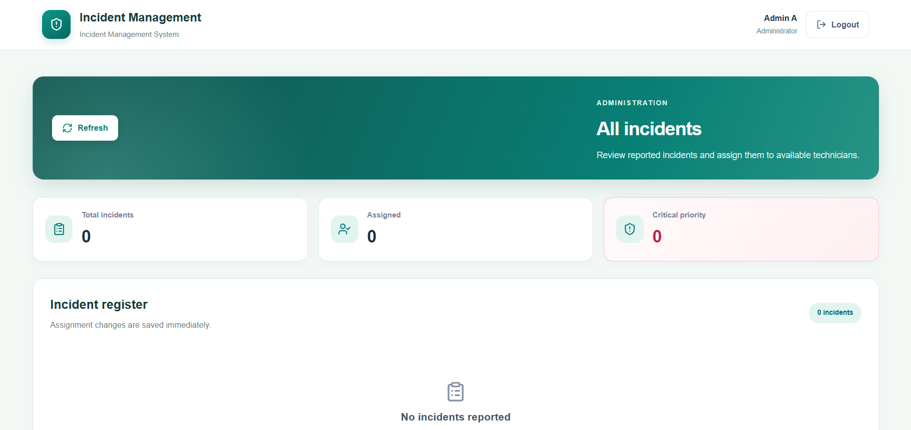

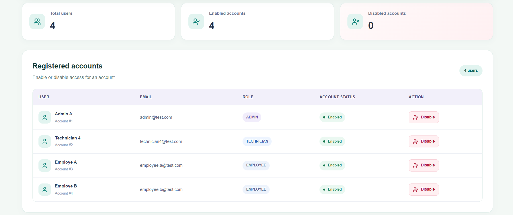
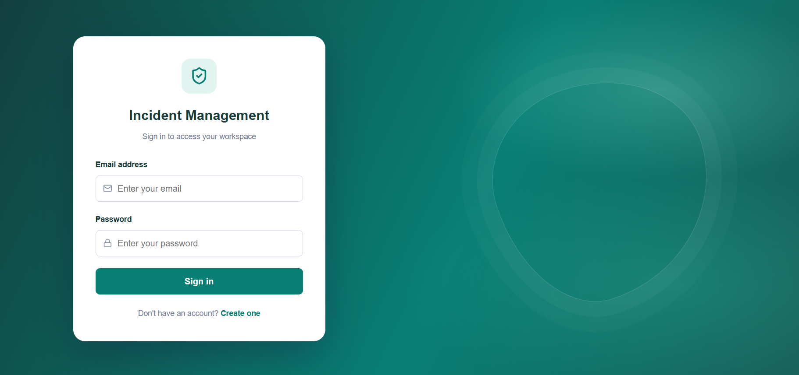
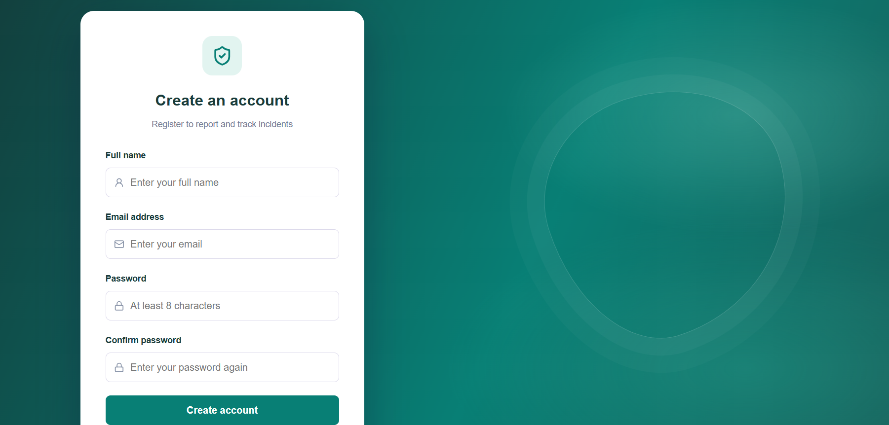

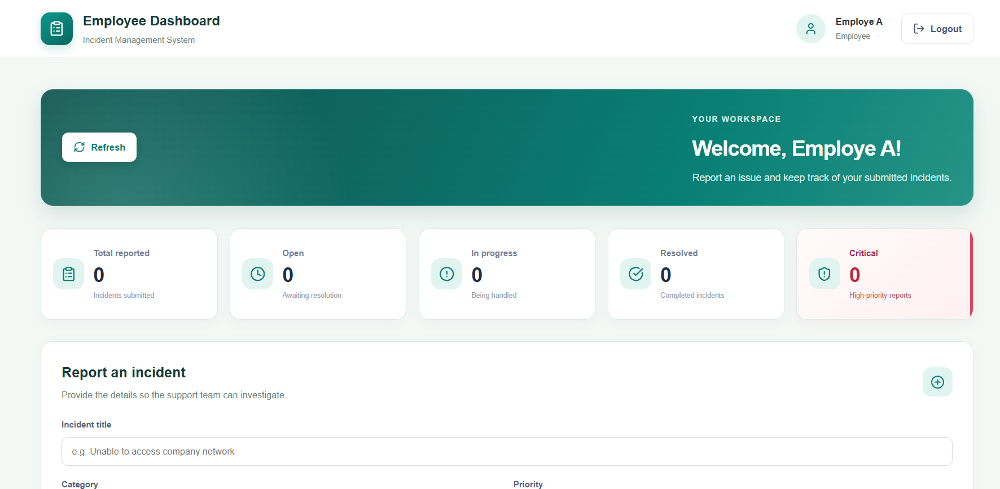
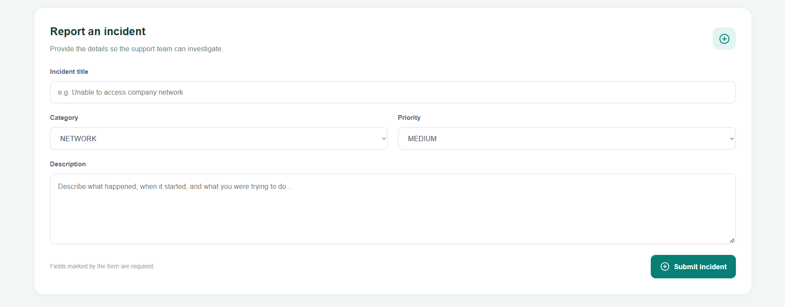
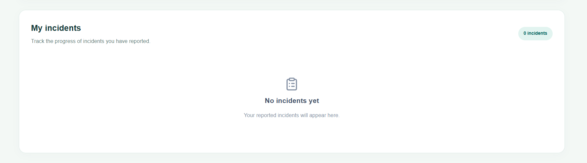
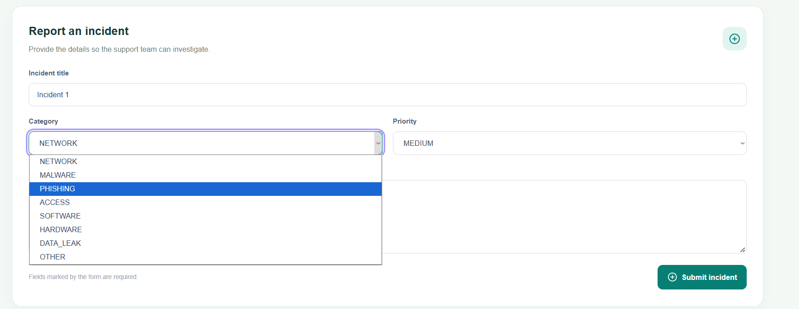

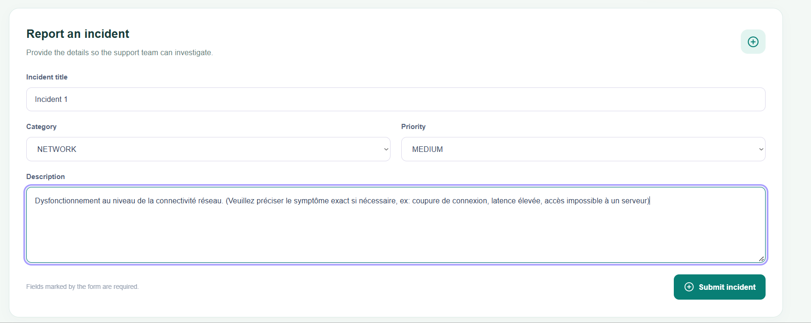
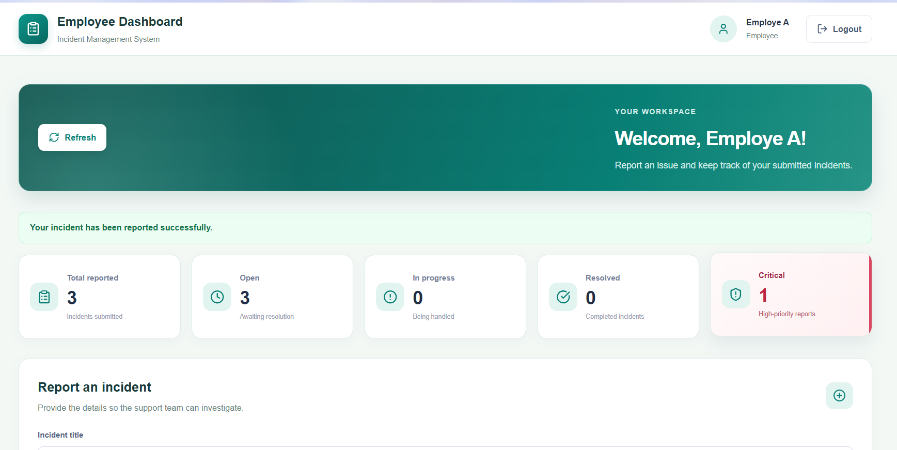
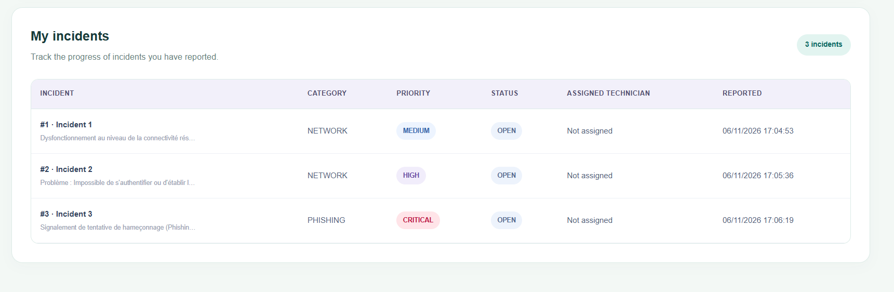
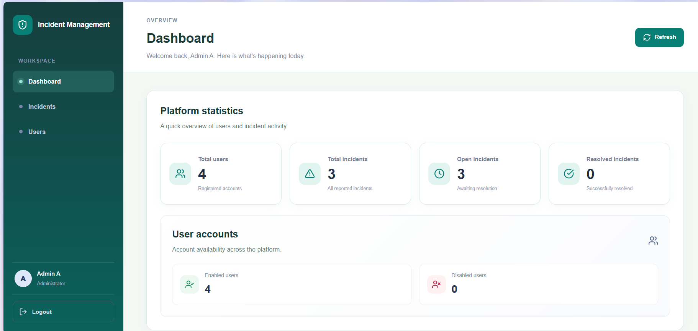

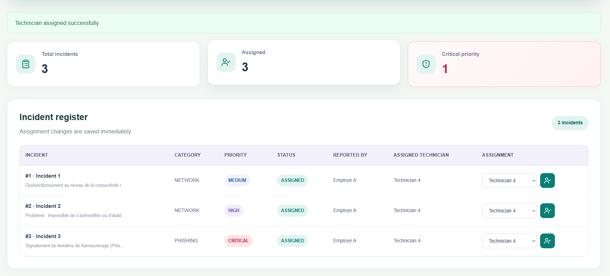
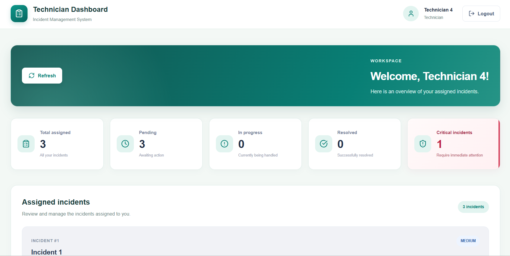
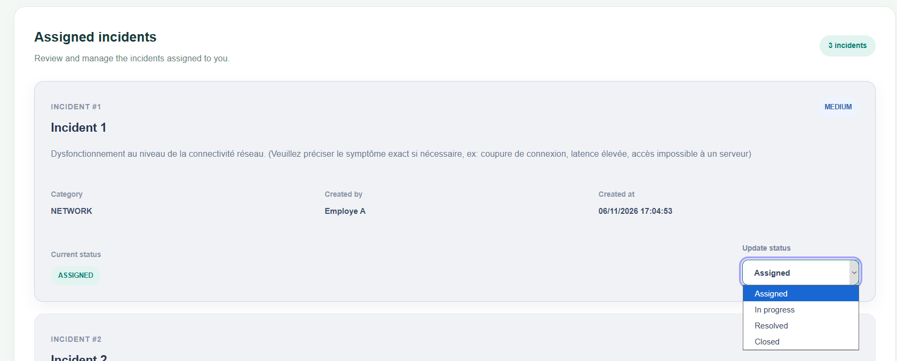


</details>

## Auteur

**BALMIR Salma**  
Master SDIA — ENSET Mohammedia
